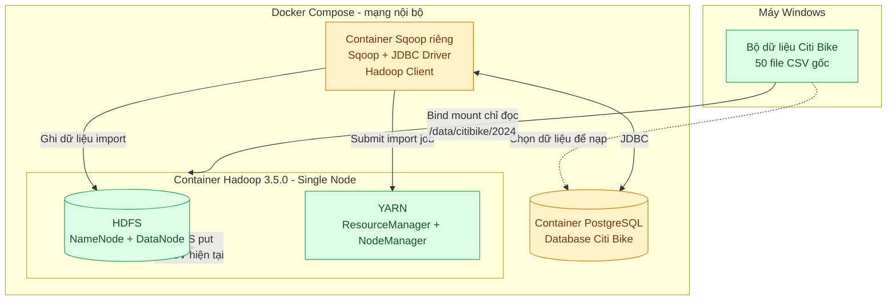

## Lộ trình triển khai

| Giai đoạn | Công việc                                       |
| :-------: | ----------------------------------------------- |
|     1     | Kiểm tra Java và Hadoop hiện tại                |
|     2     | Thêm PostgreSQL vào Docker Compose              |
|     3     | Tạo database, bảng và nạp dữ liệu               |
|     4     | Xây dựng container Sqoop riêng                  |
|     5     | Cấu hình JDBC và kết nối PostgreSQL             |
|     6     | Thực hiện Sqoop inport vào HDFS                 |
|     7     | Kiểm tra dữ liệu và cập nhật tài liệu kiến trúc |

## 1. Kiểm tra Java

```powershell
docker compose exec hadoop java -version
```

```text
PS D:\Dev\BigData_CitiBike> docker compose exec hadoop java -version
openjdk version "17.0.18" 2026-01-20
OpenJDK Runtime Environment Temurin-17.0.18+8 (build 17.0.18+8)
OpenJDK 64-Bit Server VM Temurin-17.0.18+8 (build 17.0.18+8, mixed mode, sharing)
```

## 2. Kiểm tra Hadoop

```powershell
docker compose exec hadoop hadoop version
```

```text
PS D:\Dev\BigData_CitiBike> docker compose exec hadoop hadoop version
Hadoop 3.5.0
Source code repository https://github.com/apache/hadoop.git -r dbcc7cd797100e6b32cd84f85b53a5193a5f9af0
Compiled by cnauroth on 2026-03-24T16:56Z
Compiled on platform linux-x86_64
Compiled with protoc 3.25.5
From source with checksum 64582ed0a62a169c39a19c734a8f33b5
This command was run using /opt/hadoop/share/hadoop/common/hadoop-common-3.5.0.jar
```

## 3. Kiểm tra cấu hình HDFS

```powershell
docker compose exec hadoop bash -c "echo HADOOP_HOME=$HADOOP_HOME; echo HADOOP_CONF_DIR=$HADOOP_CONF_DIR; hdfs getconf -confKey fs.defaultFS"
```

```text
PS D:\Dev\BigData_CitiBike> docker compose exec hadoop bash -c "echo HADOOP_HOME=$HADOOP_HOME; echo HADOOP_CONF_DIR=$HADOOP_CONF_DIR; hdfs getconf -confKey fs.defaultFS"
HADOOP_HOME=
HADOOP_CONF_DIR=
hdfs://localhost:9000
```

## 4. Kiểm tra các thư mục và cấu hình Hadoop

```powershell
docker compose exec hadoop bash -c "echo HADOOP_HOME=/opt/hadoop; echo HADOOP_CONF_DIR=/opt/hadoop/etc/hadoop; ls -l /opt/hadoop/bin/hadoop"
```

```text
PS D:\Dev\BigData_CitiBike> docker compose exec hadoop bash -c "echo HADOOP_HOME=/opt/hadoop; echo HADOOP_CONF_DIR=/opt/hadoop/etc/hadoop; ls -l /opt/hadoop/bin/hadoop"
HADOOP_HOME=/opt/hadoop
HADOOP_CONF_DIR=/opt/hadoop/etc/hadoop
-rwxr-xr-x 1 hadoop users 9201 Mar 24  2026 /opt/hadoop/bin/hadoop
```

## 5. Kiểm tra cấu hình HDFS trước khi tạo Sqoop

```powershell
docker compose exec hadoop bash -c "cat /opt/hadoop/etc/hadoop/core-site.xml && echo '========== HDFS SITE ==========' && cat /opt/hadoop/etc/hadoop/hdfs-site.xml"
```

```text
PS D:\Dev\BigData_CitiBike> docker compose exec hadoop bash -c "cat /opt/hadoop/etc/hadoop/core-site.xml && echo '========== HDFS SITE ==========' && cat /opt/hadoop/etc/hadoop/hdfs-site.xml"
<?xml version="1.0"?>
<configuration>
    <property>
        <name>fs.defaultFS</name>
        <value>hdfs://localhost:9000</value>
    </property>

    <property>
        <name>hadoop.tmp.dir</name>
        <value>/opt/hadoop/data/tmp</value>
    </property>
</configuration>
========== HDFS SITE ==========
<?xml version="1.0"?>
<configuration>
    <!-- Chỉ có một DataNode nên replication = 1 -->
    <property>
        <name>dfs.replication</name>
        <value>1</value>
    </property>

    <!-- Thư mục lưu metadata của NameNode -->
    <property>
        <name>dfs.namenode.name.dir</name>
        <value>file:///opt/hadoop/data/namenode</value>
    </property>

    <!-- Thư mục lưu các block dữ liệu của DataNode -->
    <property>
        <name>dfs.datanode.data.dir</name>
        <value>file:///opt/hadoop/data/datanode</value>
    </property>

    <!-- Địa chỉ giao tiếp RPC của NameNode -->
    <property>
        <name>dfs.namenode.rpc-address</name>
        <value>0.0.0.0:9000</value>
    </property>

    <!-- Giao diện quản lý NameNode -->
    <property>
        <name>dfs.namenode.http-address</name>
        <value>0.0.0.0:9870</value>
    </property>
</configuration>
```

## 6. Cần kiểm tra thêm cấu hình YARN

```powershell
docker compose exec hadoop bash -c "cat /opt/hadoop/etc/hadoop/yarn-site.xml && echo '========== MAPRED SITE ==========' && cat /opt/hadoop/etc/hadoop/mapred-site.xml"
```

```text
PS D:\Dev\BigData_CitiBike> docker compose exec hadoop bash -c "cat /opt/hadoop/etc/hadoop/yarn-site.xml && echo '========== MAPRED SITE ==========' && cat /opt/hadoop/etc/hadoop/mapred-site.xml"
<?xml version="1.0"?>
<configuration>
    <!-- Địa chỉ ResourceManager -->
    <property>
        <name>yarn.resourcemanager.hostname</name>
        <value>localhost</value>
    </property>

    <!-- Cấu hình dịch vụ hỗ trợ MapReduce -->
    <property>
        <name>yarn.nodemanager.aux-services</name>
        <value>mapreduce_shuffle</value>
    </property>

    <property>
        <name>yarn.nodemanager.aux-services.mapreduce_shuffle.class</name>
        <value>org.apache.hadoop.mapred.ShuffleHandler</value>
    </property>

    <!-- Giới hạn tài nguyên NodeManager sử dụng -->
    <property>
        <name>yarn.nodemanager.resource.memory-mb</name>
        <value>2048</value>
    </property>

    <property>
        <name>yarn.nodemanager.resource.cpu-vcores</name>
        <value>2</value>
    </property>

    <!-- Giới hạn tài nguyên cấp phát cho mỗi tác vụ -->
    <property>
        <name>yarn.scheduler.minimum-allocation-mb</name>
        <value>512</value>
    </property>

    <property>
        <name>yarn.scheduler.maximum-allocation-mb</name>
        <value>2048</value>
    </property>

    <!-- Giao diện quản lý ResourceManager -->
    <property>
        <name>yarn.resourcemanager.webapp.address</name>
        <value>0.0.0.0:8088</value>
    </property>
</configuration>========== MAPRED SITE ==========
<?xml version="1.0"?>
<configuration>
    <!-- Sử dụng YARN làm framework thực thi MapReduce -->
    <property>
        <name>mapreduce.framework.name</name>
        <value>yarn</value>
    </property>

    <!-- Classpath cho các tiến trình MapReduce -->
    <property>
        <name>mapreduce.application.classpath</name>
        <value>/opt/hadoop/share/hadoop/mapreduce/*,/opt/hadoop/share/hadoop/mapreduce/lib/*</value>
    </property>

    <!-- Giới hạn bộ nhớ cho Map và Reduce -->
    <property>
        <name>mapreduce.map.memory.mb</name>
        <value>512</value>
    </property>

    <property>
        <name>mapreduce.reduce.memory.mb</name>
        <value>512</value>
    </property>

    <!-- Giới hạn bộ nhớ JVM cho Map và Reduce -->
    <property>
        <name>mapreduce.map.java.opts</name>
        <value>-Xmx384m</value>
    </property>

    <property>
        <name>mapreduce.reduce.java.opts</name>
        <value>-Xmx384m</value>
    </property>
</configuration>
```

## 7. Kiểm tra kết nối nội bộ Docker trước khi triển khai

```powershell
docker compose exec hadoop bash -c "getent hosts hadoop"
```

```text
PS D:\Dev\BigData_CitiBike> docker compose exec hadoop bash -c "getent hosts hadoop"
172.18.0.2      hadoop
```

## 8. Kiểm tra ResourceManager

```powershell
docker compose exec hadoop bash -c "yarn node -list"
```

```text
PS D:\Dev\BigData_CitiBike> docker compose exec hadoop bash -c "yarn node -list"
2026-11-24 10:27:58 INFO  DefaultNoHARMFailoverProxyProvider:64 - Connecting to ResourceManager at localhost/127.0.0.1:8032
Total Nodes:1
         Node-Id             Node-State Node-Http-Address   Number-of-Running-Containers
    hadoop:34617                RUNNING       hadoop:8042                              0
```

## Tổng kết

| Hạng mục                   | Trạng thái      |
| :------------------------- | :-------------- |
| Java OpenJDK 17.0.18       | OK              |
| Hadoop 3.5.0               | OK              |
| HDFS NameNode              | OK              |
| HDFS DataNode              | OK              |
| YARN ResourceManager       | OK              |
| YARN NodeManager           | RUNNING         |
| Docker DNS hostname hadoop | OK              |
| Sqoop                      | Chưa triển khai |
| PostgreSQL                 | Chưa triển khai |

## Các hostname sử dụng trong nội bộ Docker

| Kết nối                      | Địa chỉ         |
| :--------------------------- | :-------------- |
| Sqoop → PostgreSQL           | `postgres:5432` |
| Sqoop → HDFS NameNode        | `hadoop:9000`   |
| Sqoop → YARN ResourceManager | `hadoop:8032`   |

## 9. Tạo các file trong thư mục `config\sqoop`

## 10. Kiểm tra môi trường image nền

Trước khi viết `Dockerfile.sqoop`, cần kiểm tra image có sẵn công cụ tải và giải nén để lựa chọn cách cài đặt phù hợp.

```powershell
docker compose exec hadoop bash -c "cat /etc/os-release; echo '========== TOOLS =========='; command -v curl; command -v wget; command -v tar; echo '========== USER =========='; id"
```

```text
PS D:\Dev\BigData_CitiBike> docker compose exec hadoop bash -c "cat /etc/os-release; echo '========== TOOLS =========='; command -v curl; command -v wget; command -v tar; echo '========== USER =========='; id"
PRETTY_NAME="Ubuntu 24.04.4 LTS"
NAME="Ubuntu"
VERSION_ID="24.04"
VERSION="24.04.4 LTS (Noble Numbat)"
VERSION_CODENAME=noble
ID=ubuntu
ID_LIKE=debian
HOME_URL="https://www.ubuntu.com/"
SUPPORT_URL="https://help.ubuntu.com/"
BUG_REPORT_URL="https://bugs.launchpad.net/ubuntu/"
PRIVACY_POLICY_URL="https://www.ubuntu.com/legal/terms-and-policies/privacy-policy"
UBUNTU_CODENAME=noble
LOGO=ubuntu-logo
========== TOOLS ==========
/usr/bin/curl
/usr/bin/wget
/usr/bin/tar
========== USER ==========
uid=1001(hadoop) gid=100(users) groups=100(users)
```

| Thành phần    | Kết quả             |
| :------------ | :------------------ |
| Hệ điều hành  | Ubuntu 24.04.4 LTS  |
| Java          | OpenJDK 17.0.18     |
| curl          | Có                  |
| wget          | Có                  |
| tar           | Có                  |
| User mặc định | `hadoop` (UID 1001) |

## 11. Tạo `Dockerfile.sqoop`

## 12. Build Sqoop Docker image

```powershell
docker build -f Dockerfile.sqoop -t citibike-sqoop:1.4.7 .
```

```text
PS D:\Dev\BigData_CitiBike> docker build -f Dockerfile.sqoop -t citibike-sqoop:1.4.7 .
[+] Building 678.7s (11/11) FINISHED    docker:desktop-linux
 => [internal] load build definition from Dockerfile.s  0.0s
 => => transferring dockerfile: 1.38kB                  0.0s
 => [internal] load metadata for docker.io/apache/hado  0.0s
 => [internal] load .dockerignore                       0.0s
 => => transferring context: 2B                         0.0s
 => CACHED [1/6] FROM docker.io/apache/hadoop:3.5.0@sh  0.0s
 => => resolve docker.io/apache/hadoop:3.5.0@sha256:46  0.0s
 => [internal] load build context                       0.0s
 => => transferring context: 246B                       0.0s
 => [2/6] RUN mkdir -p /opt/sqoop /opt/sqoop/conf &&  670.8s
 => [3/6] RUN curl -fL https://repo1.maven.org/maven2/  1.0s
 => [4/6] RUN curl -fL https://repo1.maven.org/maven2/  0.6s
 => [5/6] COPY config/sqoop/ /opt/sqoop/conf/           0.1s
 => [6/6] RUN chown -R hadoop:users /opt/sqoop          4.1s
 => exporting to image                                  1.8s
 => => exporting layers                                 1.0s
 => => exporting manifest sha256:34966fd6b814665273a36  0.0s
 => => exporting config sha256:cba1278e84aa969c1ccd065  0.0s
 => => exporting attestation manifest sha256:a85d2c731  0.0s
 => => exporting manifest list sha256:3158deb979a1ab47  0.0s
 => => naming to docker.io/library/citibike-sqoop:1.4.  0.0s
 => => unpacking to docker.io/library/citibike-sqoop:1  0.7s

View build details: docker-desktop://dashboard/build/desktop-linux/desktop-linux/jhvq9fsbnx16mufavoa1bsqbf
```

## 13. Kiểm tra Sqoop trong image

```powershell
docker run --rm --network bigdata_citibike_default citibike-sqoop:1.4.7 sqoop version
```

```text
PS D:\Dev\BigData_CitiBike> docker run --rm --network bigdata_citibike_default citibike-sqoop:1.4.7 sqoop version
Warning: /opt/sqoop/../hbase does not exist! HBase imports will fail.
Please set $HBASE_HOME to the root of your HBase installation.
Warning: /opt/sqoop/../hcatalog does not exist! HCatalog jobs will fail.
Please set $HCAT_HOME to the root of your HCatalog installation.
Warning: /opt/sqoop/../accumulo does not exist! Accumulo imports will fail.
Please set $ACCUMULO_HOME to the root of your Accumulo installation.
Warning: /opt/sqoop/../zookeeper does not exist! Accumulo imports will fail.
Please set $ZOOKEEPER_HOME to the root of your Zookeeper installation.
2026-11-24 12:10:32 INFO  Sqoop:96 - Running Sqoop version: 1.4.7
Sqoop 1.4.7
git commit id 2328971411f57f0cb683dfb79d19d4d19d185dd8
Compiled by maugli on Thu Dec 21 15:59:58 STD 2017
```

## 14. Kiểm tra Sqoop truy cập HDFS

```powershell
docker run --rm --network bigdata_citibike_default --entrypoint hdfs citibike-sqoop:1.4.7 dfs -ls /
```

```text
PS D:\Dev\BigData_CitiBike> docker run --rm --network bigdata_citibike_default --entrypoint hdfs citibike-sqoop:1.4.7 dfs -ls /
WARNING: log4j.properties is not found. HADOOP_CONF_DIR may be incomplete.
Found 1 items
drwxr-xr-x   - hadoop supergroup          0 2026-11-24 09:45 /citibike
```

| Thành phần                     | Trạng thái            |
| :----------------------------- | :-------------------- |
| Hadoop 3.5.0                   | Hoạt động             |
| HDFS                           | Đọc/ghi đã kiểm tra   |
| YARN                           | NodeManager hoạt động |
| Sqoop 1.4.7                    | CLI khởi chạy         |
| Sqoop → HDFS                   | Kết nối thành công    |
| PostgreSQL                     | Chưa triển khai       |
| Sqoop Import PostgreSQL → HDFS | Chưa kiểm tra         |

## 15. Sửa file `docker-compose.yml`

## 16. Khởi chạy riêng PostgreSQL

```powershell
docker compose up -d postgres
```

```text
PS D:\Dev\BigData_CitiBike> docker compose up -d postgres
[+] up 18/18
 ✔ Image postgres:16                     Pulled         30.1s
 ✔ Volume bigdata_citibike_postgres_data Created         0.0s
 ✔ Container citibike-postgres           Started         1.0s
PS D:\Dev\BigData_CitiBike>
```

## 17. Kiểm tra trạng thái

```powershell
docker compose ps postgres
```

```text
PS D:\Dev\BigData_CitiBike> docker compose ps postgres
NAME                IMAGE         COMMAND                  SERVICE    CREATED              STATUS                        PORTS
citibike-postgres   postgres:16   "docker-entrypoint.s…"   postgres   About a minute ago   Up About a minute (healthy)   5432/tcp
```

## 18. Kiểm tra khả năng kết nối và thông tin database

```powershell
docker compose exec postgres psql -U citibike -d citibike -c "\conninfo"
```

```text
PS D:\Dev\BigData_CitiBike> docker compose exec postgres psql -U citibike -d citibike -c "\conninfo"
You are connected to database "citibike" as user "citibike" via socket in "/var/run/postgresql" at port "5432".
```

## 19. Tạo bảng `citibike_trips`

```powershell
docker compose exec postgres psql -U citibike -d citibike -c "CREATE TABLE citibike_trips (ride_id VARCHAR(64) PRIMARY KEY, rideable_type VARCHAR(32), started_at TIMESTAMP, ended_at TIMESTAMP, start_station_name TEXT, start_station_id VARCHAR(64), end_station_name TEXT, end_station_id VARCHAR(64), start_lat DOUBLE PRECISION, start_lng DOUBLE PRECISION, end_lat DOUBLE PRECISION, end_lng DOUBLE PRECISION, member_casual VARCHAR(16));"
```

```text
PS D:\Dev\BigData_CitiBike> docker compose exec postgres psql -U citibike -d citibike -c "CREATE TABLE citibike_trips (ride_id VARCHAR(64) PRIMARY KEY, rideable_type VARCHAR(32), started_at TIMESTAMP, ended_at TIMESTAMP, start_station_name TEXT, start_station_id VARCHAR(64), end_station_name TEXT, end_station_id VARCHAR(64), start_lat DOUBLE PRECISION, start_lng DOUBLE PRECISION, end_lat DOUBLE PRECISION, end_lng DOUBLE PRECISION, member_casual VARCHAR(16));"
CREATE TABLE
```

## 20. Cho PostgreSQL truy cập các file CSV

Ta sẽ sử dụng bind mount để chia sẻ thư mục CSV từ Windows vào container PostgreSQL ở chế độ chỉ đọc (ro).

Mở `docker-compose.yml`, tìm service `postgres`, bổ sung phần `volumes` như sau:

```yaml
postgres:
  image: postgres:16
  container_name: citibike-postgres
  hostname: postgres
  environment:
    POSTGRES_DB: citibike
    POSTGRES_USER: citibike
    POSTGRES_PASSWORD: citibike_dev_password
  volumes:
    - postgres_data:/var/lib/postgresql/data
    - ./datasets/raw/citibike/2024:/data/citibike/2024:ro
```

## 21. Áp dụng cấu hình mới

```powershell
docker compose up -d postgres
```

```text
PS D:\Dev\BigData_CitiBike> docker compose up -d postgres
[+] up 1/1
 ✔ Container citibike-postgres Started                   0.6s
```

## 22. Kiểm tra container có nhìn thấy các file CSV từ Windows hay không

```powershell
docker compose exec postgres ls -lh /data/citibike/2024
```

## 23. Kiểm trả khả năng đọc CSV

```powershell
docker compose exec postgres bash -c "head -n 2 /data/citibike/2024/202401-citibike-tripdata_1.csv"
```

```text
PS D:\Dev\BigData_CitiBike> docker compose exec postgres bash -c "head -n 2 /data/citibike/2024/202401-citibike-tripdata_1.csv"
ride_id,rideable_type,started_at,ended_at,start_station_name,start_station_id,end_station_name,end_station_id,start_lat,start_lng,end_lat,end_lng,member_casual
8E865410DBDE0CA9,electric_bike,2024-01-01 13:00:04.563,2024-01-01 13:04:04.652,3 St & 3 Ave,4028.03,Carroll St & Smith St,4225.14,40.6750705,-73.98775226,40.680611,-73.99475825,casual
PS D:\Dev\BigData_CitiBike>
```

## 24. Nạp file CSV đầu tiên

Ta sẽ nạp từng file một để dễ kiểm soát lỗi và tiến độ. PostgreSQL sử dụng lệnh \copy thông qua psql, đọc trực tiếp file trong container.

```powershell
docker compose exec postgres psql -U citibike -d citibike -c "\copy citibike_trips FROM '/data/citibike/2024/202401-citibike-tripdata_1.csv' WITH (FORMAT CSV, HEADER TRUE)"
```

Lệnh này sẽ:

- Bỏ qua dòng header.
- Đọc dữ liệu CSV.
- Tự chuyển timestamp và tọa độ sang kiểu dữ liệu PostgreSQL.
- Nạp dữ liệu vào citibike_trips.

```text
PS D:\Dev\BigData_CitiBike> docker compose exec postgres psql -U citibike -d citibike -c "\copy citibike_trips FROM '/data/citibike/2024/202401-citibike-tripdata_1.csv' WITH (FORMAT CSV, HEADER TRUE)"
COPY 1000000
```

File 2

```powershell
docker compose exec postgres psql -U citibike -d citibike -c "\copy citibike_trips FROM '/data/citibike/2024/202401-citibike-tripdata_2.csv' WITH (FORMAT CSV, HEADER TRUE)"
```

```text
PS D:\Dev\BigData_CitiBike> docker compose exec postgres psql -U citibike -d citibike -c "\copy citibike_trips FROM '/data/citibike/2024/202401-citibike-tripdata_2.csv' WITH (FORMAT CSV, HEADER TRUE)"
COPY 888085
```

```text
PS D:\Dev\BigData_CitiBike> docker compose exec postgres psql -U citibike -d citibike -c "\copy citibike_trips FROM '/data/citibike/2024/202402-citibike-tripdata_1.csv' WITH (FORMAT CSV, HEADER TRUE)"
COPY 1000000
PS D:\Dev\BigData_CitiBike> docker compose exec postgres psql -U citibike -d citibike -c "\copy citibike_trips FROM '/data/citibike/2024/202402-citibike-tripdata_2.csv' WITH (FORMAT CSV, HEADER TRUE)"
COPY 1000000
PS D:\Dev\BigData_CitiBike> docker compose exec postgres psql -U citibike -d citibike -c "\copy citibike_trips FROM '/data/citibike/2024/202402-citibike-tripdata_3.csv' WITH (FORMAT CSV, HEADER TRUE)"
COPY 121501
```

## 25. Kiểm tra dữ liệu trong PostgreSQL

```powershell
docker compose exec postgres psql -U citibike -d citibike -c "SELECT COUNT(*) AS total_records, COUNT(DISTINCT ride_id) AS unique_rides, MIN(started_at) AS earliest_ride, MAX(started_at) AS latest_ride FROM citibike_trips;"
```

```text
...skipping...
 total_records | unique_rides |      earliest_ride      |       latest_ride
---------------+--------------+-------------------------+-------------------------
       4009586 |      4009586 | 2023-12-31 02:36:55.648 | 2024-02-29 23:56:05.845
(1 row)

~
(END)
```

## 26. Kiểm tra Sqoop kết nối PostgreSQL

```powershell
docker run --rm --network bigdata_citibike_default --entrypoint sqoop citibike-sqoop:1.4.7 list-tables --connect jdbc:postgresql://postgres:5432/citibike --username citibike --password citibike_dev_password
```

```text
PS D:\Dev\BigData_CitiBike> docker run --rm --network bigdata_citibike_default --entrypoint sqoop citibike-sqoop:1.4.7 list-tables --connect jdbc:postgresql://postgres:5432/citibike --username citibike --password citibike_dev_password
Warning: /opt/sqoop/../hbase does not exist! HBase imports will fail.
Please set $HBASE_HOME to the root of your HBase installation.
Warning: /opt/sqoop/../hcatalog does not exist! HCatalog jobs will fail.
Please set $HCAT_HOME to the root of your HCatalog installation.
Warning: /opt/sqoop/../accumulo does not exist! Accumulo imports will fail.
Please set $ACCUMULO_HOME to the root of your Accumulo installation.
Warning: /opt/sqoop/../zookeeper does not exist! Accumulo imports will fail.
Please set $ZOOKEEPER_HOME to the root of your Zookeeper installation.
WARNING: log4j.properties is not found. HADOOP_CONF_DIR may be incomplete.
2026-11-24 13:02:10,480 INFO  [main] sqoop.Sqoop (Sqoop.java:<init>(96)) - Running Sqoop version: 1.4.7
2026-11-24 13:02:10,524 WARN  [main] tool.BaseSqoopTool (BaseSqoopTool.java:applyCredentialsOptions(1120)) - Setting your password on the command-line is insecure. Consider using -P instead.
2026-11-24 13:02:10,616 INFO  [main] Configuration.deprecation (Configuration.java:logDeprecation(412)) - mapred.map.tasks.speculative.execution in oraoop-site-template.xml is deprecated. Instead, use mapreduce.map.speculative
2026-11-24 13:02:10,649 INFO  [main] manager.SqlManager (SqlManager.java:initOptionDefaults(98)) - Using default fetchSize of 1000
citibike_trips
```

## 27. Chỉnh sửa `config/yarn-site.xml`

```xml
    <!-- Cho phép ResourceManager nhận kết nối từ các container khác -->
    <property>
        <name>yarn.resourcemanager.bind-host</name>
        <value>0.0.0.0</value>
    </property>
```

## 28. Khởi động lại Hadoop

```powershell
docker compose up -d --build hadoop
```

```text
PS D:\Dev\BigData_CitiBike> docker compose up -d --build hadoop
[+] Building 2.3s (14/14) FINISHED
 => [internal] load local bake definitions              0.0s
 => => reading from stdin 521B                          0.0s
 => [internal] load build definition from Dockerfile    0.1s
 => => transferring dockerfile: 934B                    0.0s
 => [internal] load metadata for docker.io/apache/hado  0.1s
 => [internal] load .dockerignore                       0.0s
 => => transferring context: 2B                         0.0s
 => [1/7] FROM docker.io/apache/hadoop:3.5.0@sha256:46  0.0s
 => => resolve docker.io/apache/hadoop:3.5.0@sha256:46  0.0s
 => [internal] load build context                       0.0s
 => => transferring context: 5.12kB                     0.0s
 => CACHED [2/7] COPY --chown=hadoop:users config/core  0.0s
 => CACHED [3/7] COPY --chown=hadoop:users config/hdfs  0.0s
 => [4/7] COPY --chown=hadoop:users config/yarn-site.x  0.1s
 => [5/7] COPY --chown=hadoop:users config/mapred-site  0.1s
 => [6/7] COPY --chown=hadoop:users scripts/start-sing  0.1s
 => [7/7] RUN mkdir -p /opt/hadoop/data/namenode     /  0.5s
 => exporting to image                                  0.5s
 => => exporting layers                                 0.2s
 => => exporting manifest sha256:15d5305ef9eff0e1de8b1  0.0s
 => => exporting config sha256:6a4c520de4d298fc0ddbed0  0.0s
 => => exporting attestation manifest sha256:925d2ad7d  0.0s
 => => exporting manifest list sha256:939b787deeb8113c  0.0s
 => => naming to docker.io/library/bigdata_citibike-ha  0.0s
 => => unpacking to docker.io/library/bigdata_citibike  0.1s
 => resolving provenance for metadata file              0.0s
[+] up 2/2
 ✔ Image bigdata_citibike-hadoop Built                   2.5s
 ✔ Container hadoop-single-node  Started                 1.8s
```

## 29. Kiểm tra YARN trong container Hadoop

```powershell
docker compose exec hadoop yarn node -list
```

```text
PS D:\Dev\BigData_CitiBike> docker compose exec hadoop yarn node -list
2026-11-24 13:14:43 INFO  DefaultNoHARMFailoverProxyProvider:64 - Connecting to ResourceManager at localhost/127.0.0.1:8032
Total Nodes:1
         Node-Id             Node-State Node-Http-Address   Number-of-Running-Containers
    hadoop:42303                RUNNING       hadoop:8042                              0
```

## 30. Kiểm tra Sqoop có thể truy cập YARN

Sqoop đã kết nối PostgreSQL và trước đó cũng đọc được HDFS. Tuy nhiên, để import bằng MapReduce, nó còn phải gửi job đến YARN.

```powershell
docker run --rm --network bigdata_citibike_default --entrypoint yarn citibike-sqoop:1.4.7 node -list
```

```powershell
PS D:\Dev\BigData_CitiBike> docker run --rm --network bigdata_citibike_default --entrypoint yarn citibike-sqoop:1.4.7 node -list
WARNING: log4j.properties is not found. HADOOP_CONF_DIR may be incomplete.
2026-11-24 13:16:27,814 INFO  [main] client.DefaultNoHARMFailoverProxyProvider (DefaultNoHARMFailoverProxyProvider.java:init(64)) - Connecting to ResourceManager at hadoop/172.18.0.2:8032
Total Nodes:1
         Node-Id             Node-State Node-Http-Address   Number-of-Running-Containers
    hadoop:42303                RUNNING       hadoop:8042                              0
```

## 31. Lấy một bản ghi mẫu từ PostgreSQL

```powershell
docker compose exec postgres psql -U citibike -d citibike -Atc "SELECT ride_id FROM citibike_trips LIMIT 1;"
```

```text
PS D:\Dev\BigData_CitiBike> docker compose exec postgres psql -U citibike -d citibike -Atc "SELECT ride_id FROM citibike_trips LIMIT 1;"
8E865410DBDE0CA9
```

## 32. Bổ sung hostname cho DataNode

Trong file config/hdfs-site.xml, thêm đoạn sau ngay sau thuộc tính dfs.datanode.data.dir:

```xml
    <!-- Địa chỉ hostname DataNode quảng bá cho các client -->
    <property>
        <name>dfs.datanode.hostname</name>
        <value>hadoop</value>
    </property>
```

## 33. Build lại và khởi động Hadoop

```powershell
docker compose up -d --build hadoop
```

## 34. Cấu hình Sqoop sử dụng DataNode hostname `config/sqoop/hdfs-site.xml`

```xml
<property>
    <name>dfs.client.use.datanode.hostname</name>
    <value>true</value>
</property>
```

## 35. Build lại image Sqoop

```powershell
docker build -f Dockerfile.sqoop -t citibike-sqoop:1.4.7 .
```

## 36. Chạy thử Sqoop Import một bản ghi

```powershell
docker run --rm --network bigdata_citibike_default --entrypoint sqoop citibike-sqoop:1.4.7 import --connect "jdbc:postgresql://postgres:5432/citibike" --username citibike --password citibike_dev_password --table citibike_trips --where "ride_id='8E865410DBDE0CA9'" --target-dir /citibike/sqoop/test_import --num-mappers 1 --delete-target-dir
```

Lệnh này thực hiện:

- Kết nối PostgreSQL thông qua JDBC.
- Lọc đúng một bản ghi bằng ride_id.
- Chạy một mapper trên YARN.
- Ghi dữ liệu vào HDFS tại /citibike/sqoop/test_import.
- Xóa thư mục đích cũ nếu đã tồn tại.

## 37. Kiểm tra dữ liệu thực tế trong HDFS

```powershell
docker compose exec hadoop hdfs dfs -ls /citibike/sqoop/test_import
```

```text
PS D:\Dev\BigData_CitiBike> docker compose exec hadoop hdfs dfs -ls /citibike/sqoop/test_import
Found 2 items
-rw-r--r--   1 hadoop supergroup          0 2026-11-24 13:30 /citibike/sqoop/test_import/_SUCCESS
-rw-r--r--   1 hadoop supergroup        184 2026-11-24 13:30 /citibike/sqoop/test_import/part-m-00000
```

Đọc nội dung

```powershell
docker compose exec hadoop hdfs dfs -cat /citibike/sqoop/test_import/part-m-00000
```

## 38. Import toàn bộ bảng PostgreSQL bằng 1 Mapper

```powershell
docker compose exec hadoop hdfs dfs -rm -r /citibike/sqoop/test_import
```

```text
PS D:\Dev\BigData_CitiBike> docker compose exec hadoop hdfs dfs -rm -r /citibike/sqoop/test_import
Deleted /citibike/sqoop/test_import
```

```powershell
docker run --rm --network bigdata_citibike_default --entrypoint sqoop citibike-sqoop:1.4.7 import -D "mapreduce.job.maps=1" --connect "jdbc:postgresql://postgres:5432/citibike" --username citibike --password citibike_dev_password --table citibike_trips --target-dir /citibike/sqoop/citibike_trips --num-mappers 1
```

| Chỉ số               | Kết quả                        |
| :------------------- | :----------------------------- |
| Map task đã chạy     | 1                              |
| Map input records    | 4.009.586                      |
| Map output records   | 4.009.586                      |
| Dữ liệu ghi vào HDFS | 783.076.780 bytes (~746,80 MB) |
| Thời gian truyền     | ~33,53 giây (22,27 MB/s)       |
| Failed Shuffle       | 0                              |

## 39. Kiểm tra lại số bản ghi PostgreSQL

```powershell
docker compose exec postgres psql -U citibike -d citibike -c "SELECT COUNT(*) AS total_records, COUNT(DISTINCT ride_id) AS unique_rides FROM citibike_trips;"
```

```text
PS D:\Dev\BigData_CitiBike> docker compose exec postgres psql -U citibike -d citibike -c "SELECT COUNT(*) AS total_records, COUNT(DISTINCT ride_id) AS unique_rides FROM citibike_trips;"
 total_records | unique_rides
---------------+--------------
       4009586 |      4009586
(1 row)
```

## 40. Kiểm tra dữ liệu thực tế trong HDFS

```powershell
docker compose exec hadoop hdfs dfs -ls -h /citibike/sqoop/citibike_trips
```

```text
PS D:\Dev\BigData_CitiBike> docker compose exec hadoop hdfs dfs -ls -h /citibike/sqoop/citibike_trips
Found 2 items
-rw-r--r--   1 hadoop supergroup          0 2026-11-24 13:49 /citibike/sqoop/citibike_trips/_SUCCESS
-rw-r--r--   1 hadoop supergroup    746.8 M 2026-11-24 13:49 /citibike/sqoop/citibike_trips/part-m-00000
```

## 41. Đếm số dòng thực tế trong HDFS

```powershell
docker compose exec hadoop bash -c "hdfs dfs -cat /citibike/sqoop/citibike_trips/part-m-00000 | wc -l"
```

```text
PS D:\Dev\BigData_CitiBike> docker compose exec hadoop bash -c "hdfs dfs -cat /citibike/sqoop/citibike_trips/part-m-00000 | wc -l"
4009586
```

## Cập nhật tiến độ toàn bộ đề tài

| Công nghệ     | Tiến độ              |
| :------------ | :------------------- |
| Hadoop 3.5.0  | Đã cài đặt           |
| HDFS          | Đọc / ghi thành công |
| YARN          | Hoạt động            |
| PostgreSQL 16 | Đã triển khai        |
| Sqoop 1.4.7   | Import thành công    |
| HBase         | Chưa triển khai      |
| Flume         | Chưa triển khai      |
| Hive          | Chưa triển khai      |
| Pig           | Chưa triển khai      |
| Oozie         | Chưa triển khai      |
